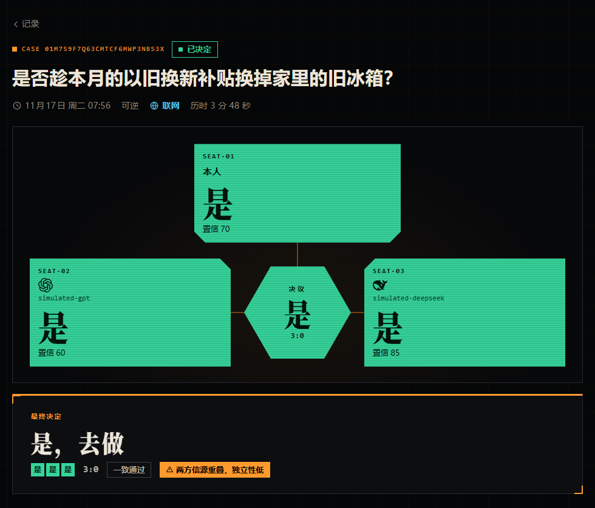
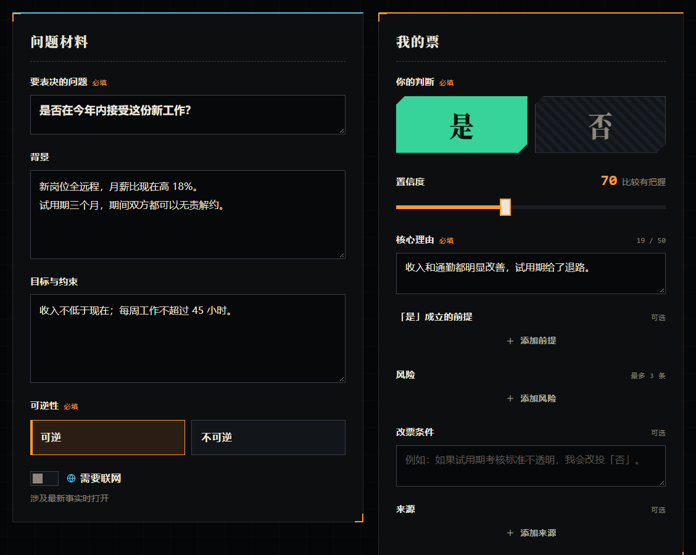
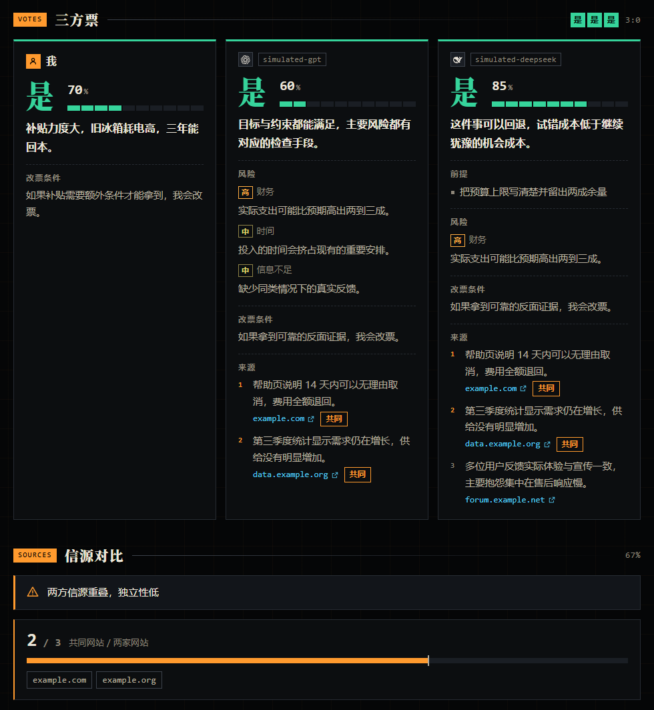
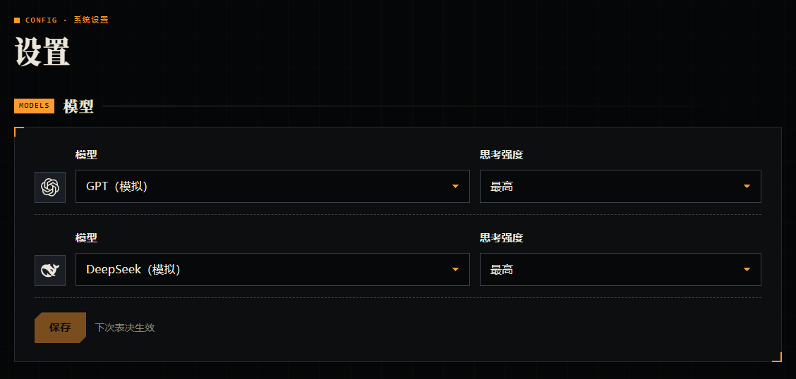
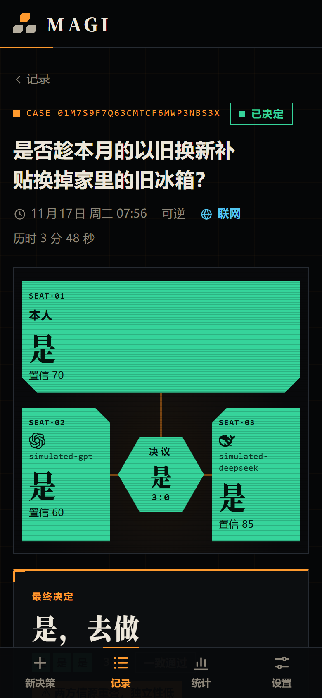

# MAGI

**English** · [简体中文](README.zh-CN.md)

MAGI is a self-hosted, single-user decision system. For each yes/no decision, three seats vote independently: you, GPT and DeepSeek. MAGI tallies the votes and shows the minority's reasoning. It halts on fatal risks, and once the outcome is known you record what happened, so over time you can see whose judgement holds up.

<p align="center"></p>

> The interface is in Simplified Chinese and comes in dark mode only. The name and the three-seat panel nod to the MAGI supercomputers in *Neon Genesis Evangelion*. This is an independent project with no affiliation to that franchise, OpenAI or DeepSeek.

## How a decision works

1. **Write the question.** Fill in the question, the background facts, your goals and constraints, and whether the decision can be undone. MAGI warns about leading phrases in the background (such as "I think" or "obviously") before anything is sent.
2. **Vote first.** Cast your own vote before seeing anyone else's: yes or no, a confidence from 50 to 100, a one-line reason, optional preconditions, risks with a check for each, a flip condition and sources. Your vote is locked on submit and never sent to the models.
3. **Blind model votes.** GPT and DeepSeek receive only the question material. They vote in parallel with the same system prompt and a strict JSON schema, and neither sees the other. Both votes are revealed together.
4. **Tally.** Depending on how the vote falls:
   - The majority decides.
   - If you are in the minority, or the vote is tied because one model was absent, you confirm the final answer. Your own flip condition is shown back to you first.
   - An irreversible decision with a fatal risk halts until you have completed every fatal check.
   - If both models are absent, you can run a manual technical retry.
5. **Post-mortem.** Later, record whether yes or no turned out to be right. The stats page shows each seat's accuracy and confidence calibration.

## Features

- **Minority report and risk audit.** Dissenting reasons, a merged risk checklist sorted by severity, and preconditions that "yes" depends on.
- **Optional web search per question.** Each model must cite the pages it actually retrieved, and the server checks every cited URL against the provider's search results. MAGI compares the sites the two models cite by registrable domain. If shared sites make up at least 2/3 of all cited sites, the result is flagged "两方信源重叠，独立性低" (sources overlap, low independence).
- **Model settings.** Choose the model and reasoning effort for each provider from its live catalog. Choices are stored in SQLite and apply from the next vote.
- **GPT through an OpenAI API key or your own ChatGPT plan.** DeepSeek uses its API key. Both go through the OpenAI Node SDK's Responses API.
- **Follow-ups.** Re-ask a decided question with new information; the original result is kept. Identical material is detected and not re-asked.
- **Passkeys only.** A single user signs in with WebAuthn, and new devices are registered through one-time invites created on the server.
- **Local data.** Everything is stored in one SQLite file on your machine.
- **Reliability.** Timeouts and malformed replies get one automatic retry. A request that may already have been answered when the process died is never resent.
- **Interface.** Responsive for desktop and phone, with draft auto-save, loading, empty and error states.

## Screenshots

| New decision | Votes and source comparison |
|---|---|
|  |  |
| **Settings** | **Phone** |
|  |  |

## Try it locally (no API keys needed)

This needs Node.js 22.12 or a later 22.x release.

```sh
npm ci
npm run preview:web
```

Then open <http://localhost:5199/__preview/login>.

The preview runs the real backend with an in-memory database and simulated models. Nothing is sent to outside services. It comes with nine example decisions that cover every state. Add `-- --empty` to start with no data.

Markers in the question text trigger scenarios:

| Marker | Effect |
|---|---|
| `[双是]` / `[双否]` / `[分歧]` | Both models vote yes / both vote no / GPT yes, DeepSeek no |
| `[缺席]` | DeepSeek fails and is recorded as absent |
| `[全缺席]` | Both fail the first round; a manual retry then succeeds |
| `[致命]` | GPT raises a fatal risk; with "irreversible" this triggers a halt |
| `[重叠]` | With web search on, the cited sites overlap by 2/3 |
| `[慢]` | Models take about 25 seconds, so you can watch the waiting screen |

Passkeys need HTTPS, so the preview signs you in directly. Real passkey flows are covered by `npm run test:web`.

## Self-hosting

MAGI was built to run on an always-on Mac, and the deployment scripts in `deploy/` target macOS. The Node service itself runs anywhere Node 22 does.

### Requirements

- Node.js 22.12 or a later 22.x release. On macOS: `brew install node@22`.
- A domain with HTTPS. Passkeys are bound to `RP_ID`, and the site must be served from `https://<RP_ID>`.
- A DeepSeek API key.
- For GPT, either an OpenAI API key or a ChatGPT plan that allows third-party apps.

### Install

```sh
npm ci
npm run build        # compiles the server and builds the web app into web/dist
npm test
install -m 600 .env.example .env
```

Then edit `.env`. The main settings:

| Setting | Meaning |
|---|---|
| `RP_ID` | Your domain, e.g. `magi.example.com`. **Change it**, because the example value is the author's domain. |
| `PORT`, `TRUST_PROXY` | Node listens on `127.0.0.1:PORT` behind a local reverse proxy (`TRUST_PROXY=127.0.0.1`). |
| `DB_PATH` | SQLite file. Default: `~/Library/Application Support/MAGI/magi.db`. |
| `OPENAI_AUTH_MODE` | `api_key` (set `OPENAI_API_KEY`) or `chatgpt_plan` (see below). |
| `OPENAI_MODEL`, `OPENAI_REASONING` | Initial GPT model and reasoning effort. |
| `DEEPSEEK_API_KEY`, `DEEPSEEK_MODEL`, `DEEPSEEK_THINKING` | DeepSeek key, initial model and thinking effort. |
| `MODEL_TIMEOUT_SECONDS` | Per-model timeout, 600 by default. |
| `SESSION_ABSOLUTE_HOURS`, `SESSION_IDLE_HOURS` | Session lifetime, 24 hours by default. |
| `LINT_PHRASES` | Leading phrases to warn about in the background. Set it to an empty string to turn the warning off. |

`.env` must have permission `600`, and the service checks this at startup.

Run `npm start`, then check from the same machine. `/` should return `200` and `/api/auth/me` should return `401`:

```sh
curl -s -o /dev/null -w '%{http_code}\n' http://127.0.0.1:3000/
curl -s -o /dev/null -w '%{http_code}\n' http://127.0.0.1:3000/api/auth/me
```

### Using a ChatGPT plan for GPT (optional)

Set `OPENAI_AUTH_MODE=chatgpt_plan`, then run the following on the server:

```sh
npm run chatgpt -- login     # opens the "Sign in with ChatGPT" flow
npm run chatgpt -- status    # shows the mode and whether access is authorised
npm run chatgpt -- models    # lists the models visible to that account
npm run chatgpt -- logout    # revokes the connection
```

To sign in from another computer's browser, forward the callback port over SSH. Then open `http://127.0.0.1:38473/` on that computer:

```sh
ssh -L 127.0.0.1:38473:127.0.0.1:38473 <server> \
  "cd <project> && node server/dist/scripts/chatgpt.js login --port 38473 --no-open"
```

The credentials are stored on the server only, in `~/Library/Application Support/MAGI/chatgpt/`, with directory permission 700 and file permission 600.

### HTTPS and running at boot (macOS)

`deploy/install-launchd.sh` installs launchd jobs as the service account:

- `standalone`: Homebrew Caddy terminates TLS (template in `deploy/Caddyfile`, so set your domain there). It installs Node, Caddy and DDNS LaunchDaemons. The DDNS updater targets Alibaba Cloud DNS. Fill in the `DDNS_*` settings and use `deploy/ddns/ram-policy.json` as the least-privilege policy.
- `tunnel`: installs only the Node job, for use behind a Cloudflare Tunnel that points to `http://127.0.0.1:3000`.

```sh
sh deploy/install-launchd.sh standalone
```

Any other reverse proxy on the same machine works too, as long as it serves `https://<RP_ID>` and forwards to `127.0.0.1:PORT`.

### Registering your passkey

On the server, run:

```sh
npm run invite                       # prints https://<RP_ID>/setup?token=…
npm run invite -- --ip 203.0.113.7   # optional: only this client IP may use it
```

Open the link on the device within 5 minutes, name the device and create the passkey, then sign in. Run `npm run invite` again to add a backup passkey. If every passkey is lost, run `npm run reset-credentials` in an interactive terminal on the server and type `RESET`. This revokes all credentials and sessions but keeps your decision history.

## Data and privacy

- **Sent to GPT and DeepSeek:** the question, background, goals, reversibility and any new information. Your own vote, confidence, reasons and sources are not sent. Requests set `store: false`, but each provider's own data policy still applies. Review those policies before entering sensitive material.
- **Stored locally:** everything is kept in SQLite (WAL, file permission 600). Every model attempt is recorded for auditing in the `model_attempts` table: the raw reply, the model actually returned, parameters, token usage, latency and error code.
- **Backups:** take an online snapshot with `sqlite3 "$DB" ".backup 'backup.db'"`, and include the database directory in your system backups.

## Development

| Command | What it does |
|---|---|
| `npm run dev` | Run the server from TypeScript sources (tsx) |
| `npm run build` | Compile the server and build the web app |
| `npm test` | Backend tests (Vitest): tally rules, fatal risks, concurrency, WebAuthn verification, sessions, retries, recovery, stats, web sources, DDNS |
| `npm run typecheck:web` | Type-check the web app |
| `npm run preview:web` | Local preview with simulated models |
| `npm run test:web` | End-to-end test of the web app: temporary HTTPS, a virtual authenticator and simulated models |
| `npm run test:browser` | Browser integration test against the minimal acceptance pages |

The browser tests need Chrome or Edge, passed as `MAGI_BROWSER=/path/to/browser`, and an OpenSSL that supports `-addext` (set `MAGI_TEST_OPENSSL` to use a specific one). Set `MAGI_SHOTS=<dir>` to save screenshots.

## Project layout

```
server/src        Fastify 5 API, SQLite (better-sqlite3), WebAuthn, model runner, tally logic
server/scripts    invite, ChatGPT sign-in, credential reset
server/test       Vitest suites and the browser integration test
web/src           Single-page app: vanilla TypeScript and Vite, no framework
web/scripts       Preview server, model simulator, end-to-end test
deploy/           Caddy, launchd and DDNS templates for macOS
public/           Minimal acceptance pages, used when web/dist is missing
```

## Documentation

- [API.md](API.md): the full HTTP API (Chinese)
- [web/README.md](web/README.md): web app structure, preview and conventions (Chinese)

## License

[GPL-3.0](LICENSE)
