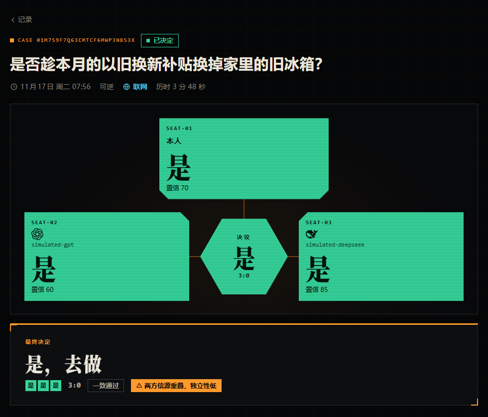
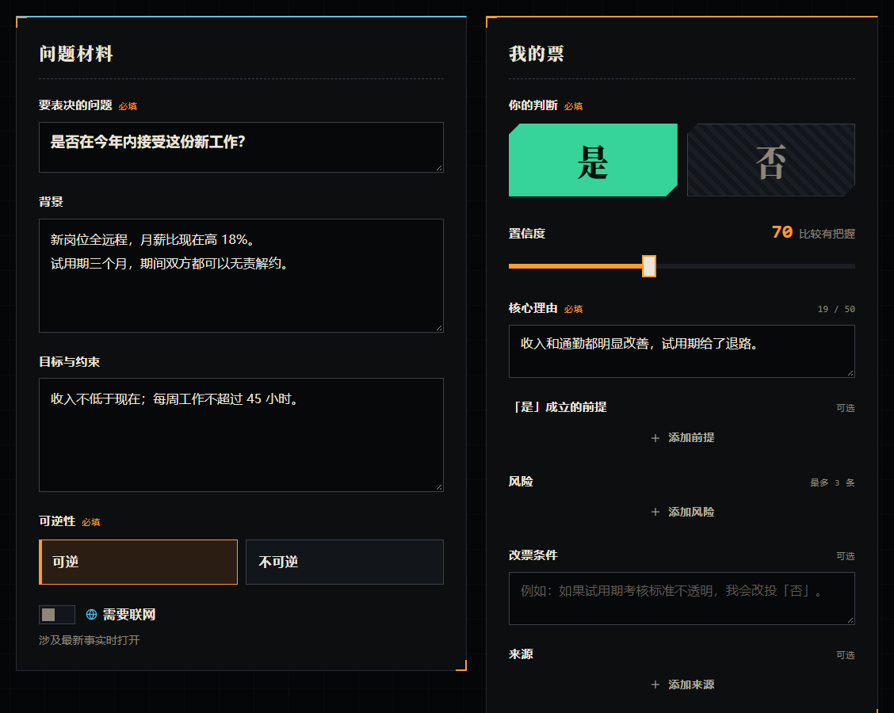
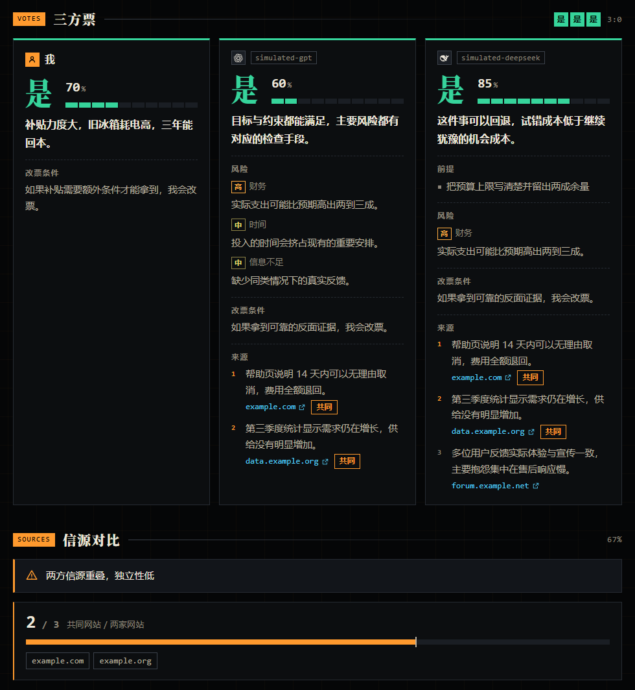
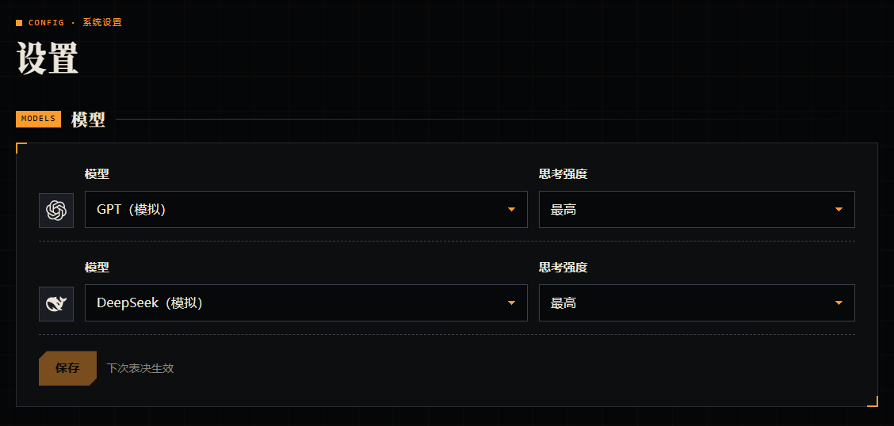
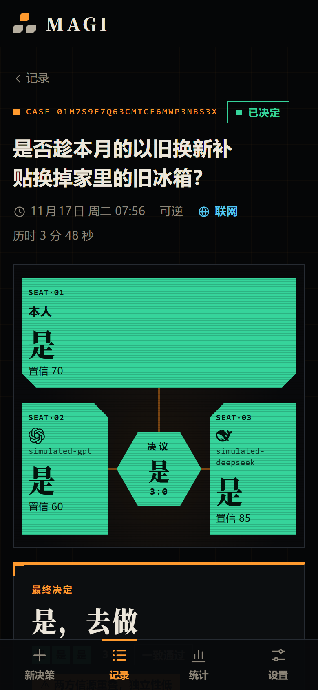

# MAGI

[English](README.md) · **简体中文**

MAGI 是一套自托管、单用户的决策系统。每个是／否决定由三方各自独立投票：你、GPT 和 DeepSeek。MAGI 负责计票，列出少数派的理由，遇到致命风险时停机，并在结果揭晓后让你记录实际发生了什么。日积月累，就能看出谁的判断更可靠。

<p align="center"></p>

> 界面为简体中文，只有深色模式。名称和三席表决面板致敬《新世纪福音战士》中的 MAGI 超级计算机。本项目独立开发，与该作品、OpenAI 和 DeepSeek 均无关联。

## 一次表决的流程

1. **写下问题。** 填写问题、背景事实、目标与约束，以及这个决定是否可逆。发送之前，MAGI 会提醒背景中带倾向性的措辞，例如「我觉得」「显然」。
2. **先投自己一票。** 在看到其他人的票之前投下自己的一票，包括是或否、50 到 100 的置信度、一句话理由，以及可选的成立前提、风险（每条配一项检查）、改票条件和来源。提交后这张票立即锁定，不会发送给模型。
3. **模型盲投。** GPT 和 DeepSeek 只收到问题材料，使用同一份系统提示词和严格的 JSON Schema 并行投票，彼此看不到对方。两张票同时揭晓。
4. **计票。** 视票型而定：
   - 多数决。
   - 你是少数派，或者一家缺席导致平票时，由你确认最终答案。确认前会先显示你自己写下的改票条件。
   - 不可逆的决定出现致命风险时停机，逐条完成所有致命项检查后才给出结论。
   - 两家都缺席时，可以手动发起技术重试。
5. **事后复盘。** 结果明朗后，记录当初是「是」对还是「否」对。统计页显示三方各自的准确率和置信度校准。

## 功能

- **少数派理由与风险检查。** 列出持异议一方的理由，按严重度合并风险清单，并列出「是」所依赖的前提。
- **按题开启联网。** 每家模型都必须引用本轮实际检索到的网页，服务端逐条核对引用的网址是否出现在供应商的检索结果中。MAGI 按可注册域名比较两家引用的网站。共同网站占两家网站总数达到 2/3 时，结果标注「两方信源重叠，独立性低」。
- **模型设置。** 按供应商的实时目录为每家选择模型和思考强度。选择保存在 SQLite，从下一次表决开始生效。
- **GPT 可用 OpenAI API Key 或自己的 ChatGPT 套餐。** DeepSeek 使用 API Key。两家都通过 OpenAI Node SDK 的 Responses 接口调用。
- **带新信息追问。** 对已决定的问题补充新事实再问一次，原结果保留。完全相同的材料会被识别，不会重复征询。
- **只用 Passkey 登录。** 单一用户通过 WebAuthn 登录，新设备通过服务器生成的一次性邀请注册。
- **数据留在本机。** 所有内容保存在本机的一个 SQLite 文件里。
- **可靠性。** 超时和格式错误的回复会自动重试一次。进程中断时，可能已经得到回复的请求不会重复发送。
- **界面。** 桌面和手机自适应，草稿自动保存，有完整的加载、空数据和错误状态。

## 截图

| 新决策 | 三方票与信源对比 |
|---|---|
|  |  |
| **设置** | **手机** |
|  |  |

## 本地体验（无需 API Key）

需要 Node.js 22.12 或更新的 22.x 版本。

```sh
npm ci
npm run preview:web
```

然后打开 <http://localhost:5199/__preview/login>。

预览运行真实后端，使用内存数据库和模拟模型，不访问任何外部服务。预置 9 条示例表决，覆盖所有状态。加 `-- --empty` 可从空数据开始。

在问题里写以下标记可触发对应情景：

| 标记 | 情景 |
|---|---|
| `[双是]` / `[双否]` / `[分歧]` | 两家都投是／都投否／GPT 投是、DeepSeek 投否 |
| `[缺席]` | DeepSeek 连接失败，记为缺席 |
| `[全缺席]` | 两家首轮都失败，手动技术重试后成功 |
| `[致命]` | GPT 提出致命风险，配合「不可逆」触发停机检查 |
| `[重叠]` | 打开联网时，两家引用的网站重叠 2/3 |
| `[慢]` | 模型约 25 秒后返回，用于观察等待页 |

Passkey 需要 HTTPS，所以预览直接登录。真实的 Passkey 流程由 `npm run test:web` 覆盖。

## 自托管

MAGI 按常开的 Mac 设计，`deploy/` 中的部署脚本面向 macOS。Node 服务本身可以运行在任何支持 Node 22 的系统上。

### 准备

- Node.js 22.12 或更新的 22.x 版本。macOS 上可执行 `brew install node@22`。
- 一个可提供 HTTPS 的域名。Passkey 绑定 `RP_ID`，网站必须通过 `https://<RP_ID>` 访问。
- DeepSeek API Key。
- GPT 需要 OpenAI API Key，或允许第三方应用使用的 ChatGPT 套餐，二选一。

### 安装

```sh
npm ci
npm run build        # 编译后端，并把前端构建到 web/dist
npm test
install -m 600 .env.example .env
```

然后编辑 `.env`。主要配置：

| 配置 | 含义 |
|---|---|
| `RP_ID` | 你的域名，例如 `magi.example.com`。**务必修改**，示例值是作者的域名。 |
| `PORT`、`TRUST_PROXY` | Node 监听 `127.0.0.1:PORT`，由本机反向代理转发（`TRUST_PROXY=127.0.0.1`）。 |
| `DB_PATH` | SQLite 文件，默认 `~/Library/Application Support/MAGI/magi.db`。 |
| `OPENAI_AUTH_MODE` | `api_key`（填写 `OPENAI_API_KEY`）或 `chatgpt_plan`（见下文）。 |
| `OPENAI_MODEL`、`OPENAI_REASONING` | GPT 的初始模型和推理档位。 |
| `DEEPSEEK_API_KEY`、`DEEPSEEK_MODEL`、`DEEPSEEK_THINKING` | DeepSeek 的密钥、初始模型和思考档位。 |
| `MODEL_TIMEOUT_SECONDS` | 单家模型的超时，默认 600 秒。 |
| `SESSION_ABSOLUTE_HOURS`、`SESSION_IDLE_HOURS` | 会话有效期，默认 24 小时。 |
| `LINT_PHRASES` | 背景中需要提醒的倾向词。设为空字符串可关闭提醒。 |

`.env` 的权限必须为 `600`，服务启动时会检查。

执行 `npm start`，然后在本机检查。`/` 应返回 `200`，`/api/auth/me` 应返回 `401`：

```sh
curl -s -o /dev/null -w '%{http_code}\n' http://127.0.0.1:3000/
curl -s -o /dev/null -w '%{http_code}\n' http://127.0.0.1:3000/api/auth/me
```

### 用 ChatGPT 套餐投 GPT 票（可选）

设置 `OPENAI_AUTH_MODE=chatgpt_plan`，然后在服务器上执行：

```sh
npm run chatgpt -- login     # 打开「使用 ChatGPT 登录」授权流程
npm run chatgpt -- status    # 查看模式和授权状态
npm run chatgpt -- models    # 列出该账号可见的模型
npm run chatgpt -- logout    # 撤销连接
```

要在另一台电脑的浏览器里完成授权，先通过 SSH 转发回调端口，再在那台电脑上打开 `http://127.0.0.1:38473/`：

```sh
ssh -L 127.0.0.1:38473:127.0.0.1:38473 <服务器> \
  "cd <项目目录> && node server/dist/scripts/chatgpt.js login --port 38473 --no-open"
```

授权凭据只保存在服务器的 `~/Library/Application Support/MAGI/chatgpt/`，目录权限 700，文件权限 600。

### HTTPS 与开机运行（macOS）

`deploy/install-launchd.sh` 以服务账号身份安装 launchd 任务：

- `standalone`：由 Homebrew Caddy 终止 TLS（模板为 `deploy/Caddyfile`，需改成你的域名）。安装 Node、Caddy、DDNS 三个 LaunchDaemon。DDNS 面向阿里云解析，需要填写 `DDNS_*` 配置，并以 `deploy/ddns/ram-policy.json` 作为最小权限策略。
- `tunnel`：只安装 Node 任务，配合指向 `http://127.0.0.1:3000` 的 Cloudflare Tunnel 使用。

```sh
sh deploy/install-launchd.sh standalone
```

也可以使用本机的其他反向代理，只要它通过 `https://<RP_ID>` 提供服务并转发到 `127.0.0.1:PORT`。

### 注册 Passkey

在服务器上执行：

```sh
npm run invite                       # 打印 https://<RP_ID>/setup?token=…
npm run invite -- --ip 203.0.113.7   # 可选：只允许这个客户端 IP 使用
```

在 5 分钟内用设备打开链接，填写设备名称并创建 Passkey，然后登录。再次运行 `npm run invite` 可添加备用 Passkey。所有 Passkey 都丢失时，在服务器的交互终端运行 `npm run reset-credentials` 并输入 `RESET`。这会撤销全部凭证和会话，保留表决历史。

## 数据与隐私

- **发送给 GPT 和 DeepSeek 的内容：** 问题、背景、目标、可逆性和新增信息。你自己的票、置信度、理由和来源都不会发送。请求设置了 `store: false`，但各家供应商的数据政策仍然适用。输入敏感材料前请查阅这些政策。
- **保存在本机的内容：** 所有数据保存在 SQLite（WAL 模式，文件权限 600）。每次模型尝试都记录在 `model_attempts` 表中备查，包括原始回复、实际返回的模型名、参数、用量、耗时和错误码。
- **备份：** 用 `sqlite3 "$DB" ".backup 'backup.db'"` 生成在线快照，并把数据库目录纳入系统备份。

## 开发

| 命令 | 作用 |
|---|---|
| `npm run dev` | 直接从 TypeScript 源码运行服务（tsx） |
| `npm run build` | 编译后端并构建前端 |
| `npm test` | 后端测试（Vitest）：计票规则、致命风险、并发、WebAuthn 验证、会话、重试、恢复、统计、联网来源、DDNS |
| `npm run typecheck:web` | 前端类型检查 |
| `npm run preview:web` | 使用模拟模型的本地预览 |
| `npm run test:web` | 前端端到端测试：临时 HTTPS、虚拟验证器和模拟模型 |
| `npm run test:browser` | 针对极简验收页的浏览器集成测试 |

浏览器测试需要 Chrome 或 Edge，通过 `MAGI_BROWSER=/path/to/browser` 指定，还需要支持 `-addext` 的 OpenSSL（可用 `MAGI_TEST_OPENSSL` 指定）。设置 `MAGI_SHOTS=<目录>` 可保存截图。

## 目录结构

```
server/src        Fastify 5 接口、SQLite（better-sqlite3）、WebAuthn、模型调度与计票
server/scripts    邀请、ChatGPT 授权、凭证重置
server/test       Vitest 测试与浏览器集成测试
web/src           单页应用：原生 TypeScript 与 Vite，不依赖前端框架
web/scripts       预览服务、模拟模型、端到端测试
deploy/           面向 macOS 的 Caddy、launchd 和 DDNS 模板
public/           极简验收页，缺少 web/dist 时使用
```

## 文档

- [API.md](API.md)：完整的 HTTP 接口说明
- [web/README.md](web/README.md)：前端结构、预览与实现约定

## 许可证

[GPL-3.0](LICENSE)
